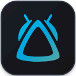

<p align="center">
  
</p>

<h1 align="center">Fishbowl</h1>

<p align="center">
  <b>Standalone Jellyfin Server 12.4.0 Host & Companion Automation Suite for Android ARM64</b><br>
  <i>Native POSIX execution on Android Bionic libc without containers, root, or virtualization.</i>
</p>

<p align="center">
  <a href="https://github.com/Suz41/Fishbowl/actions/workflows/build.yml"></a>
  <a href="https://github.com/Suz41/Fishbowl/releases/tag/v1.4.10-beta.2"></a>
  <a href="https://jellyfin.org"></a>
  <a href="https://dotnet.microsoft.com"></a>
  <a href="https://android.com"></a>
  <a href="LICENSE"></a>
</p>

---

## Overview

Fishbowl hosts Jellyfin Server 12.4.0 directly on ARM64 Android hardware using Microsoft .NET 10.0 and Android Bionic libc. It provides an unprivileged, offline-first media server environment alongside automated companion daemons, hardware diagnostics, and crash-resilient storage management.

- **Unprivileged Execution:** Runs entirely in standard user space without requiring root or unlocked bootloaders.
- **Native .NET 10 Engine:** Optimized ARM64 JIT compilation tailored for Android Bionic runtime environments.
- **Integrated Automation Stack:** Modular lifecycle management for Radarr, Sonarr, Prowlarr, Jackett, Transmission, Bazarr, Seerr, and Lidarr.
- **Hardware-Backed Protection:** Authenticated AES-256-GCM credential encryption via AndroidKeyStore.
- **Crash-Resilient Storage:** Safe atomic transactions, non-destructive quarantine with 7-day retention, and PRAGMA integrity-validated backups.
- **Zero Cloud Reliance:** 100% offline, local-network operational, with zero telemetry or tracking.

---

## Service Endpoints & Network Ports

All daemons bind to loopback and the active local LAN interface:

| Service | Port | Runtime | Primary Function |
| :--- | :--- | :--- | :--- |
| **Jellyfin Core** | `8096` | .NET 10.0 ARM64 | Media streaming server & library management |
| **Radarr** | `7878` | .NET 10.0 ARM64 | Automated movie management |
| **Sonarr** | `8989` | .NET 10.0 ARM64 | Automated TV series management |
| **Prowlarr** | `9696` | .NET 10.0 ARM64 | Indexer proxy and manager |
| **Jackett** | `9117` | .NET 10.0 ARM64 | Torznab indexer translator |
| **Transmission** | `9091` | Native C (Bionic) | Lightweight BitTorrent client |
| **Bazarr** | `6767` | Python 3.14 | Subtitle downloader and synchronizer |
| **Seerr** | `5055` | Node.js LTS | Media discovery and requests portal |
| **Lidarr** | `8686` | .NET 10.0 ARM64 | Music library automation |

---

## Quick Start

### Prerequisites
- 64-bit ARM device (`aarch64` / ARMv8)
- Android 7.0 (API 24) or newer (Android 11–16 recommended)
- 4 GB RAM minimum (6 GB+ recommended for running multiple companion daemons)

### Installation
1. Download `Fishbowl-v1.4.10-beta.2-release-universal.apk` from [Releases](https://github.com/Suz41/Fishbowl/releases/tag/v1.4.10-beta.2).
2. Install the APK and grant necessary permissions:
   - **All-Files Access (`MANAGE_EXTERNAL_STORAGE`):** Required for indexing media libraries.
   - **Battery Optimization Exemption:** Set battery usage to **Unrestricted** to allow persistent background server execution.
3. Launch Fishbowl and allow initial runtime extraction to complete.
4. Tap **Start Server** to launch Jellyfin, then select **Open Jellyfin** to access the setup wizard at `http://localhost:8096`.
5. Companion services can be provisioned and launched selectively from the **Services** tab.

---

## Storage & Backup Specifications

### Directory Architecture
Fishbowl automatically provisions a unified repository on shared storage:

```text
/storage/emulated/0/FishbowlMedia/
|-- Movies/       # Movie library collection
|-- TV/           # TV series library collection
|-- Music/        # Audio library collection
|-- Downloads/    # Download staging and temporary cache
|-- Backups/      # Timestamped configuration and database backups
`-- .quarantine/  # 7-day retention safety quarantine for orphaned folders
```

### Automated Backup & Integrity Protection
- **PRAGMA Integrity Verification:** Pre-export and pre-restore SQLite integrity assertions prevent archive corruption.
- **WAL/SHM Journal Coordination:** Stale write-ahead journals are cleaned up during restore to prevent replay corruption.
- **Rollback Snapshots:** Automated safety snapshots ensure instant rollback if restore operations are interrupted.

---

## Building from Source

```bash
# Clone the repository
git clone https://github.com/Suz41/Fishbowl.git
cd Fishbowl

# Run automated unit test suite
./gradlew testDebugUnitTest

# Assemble debug APK
./gradlew assembleDebug

# Assemble release APK (with Proguard/R8 shrinking)
./gradlew assembleRelease
```

---

## Compliance & Legal Disclosures

> [!IMPORTANT]
> **Lawful Media & Anti-Piracy Policy**
> Fishbowl is strictly an open-source personal homelab media server management utility. Fishbowl does **not** host, stream, provide, index, download, or distribute any copyrighted media files, torrents, or unlawful content.
> 
> Integrated companion daemons (such as Transmission, Radarr, Sonarr, Prowlarr, Jackett, and Bazarr) are optional, unbundled third-party open-source automation tools designed exclusively for managing personal, legally owned, Creative Commons, or public-domain media. The maintainers do not endorse, facilitate, or condone copyright infringement or digital piracy. Users assume sole and exclusive legal responsibility for complying with all applicable copyright and intellectual property laws in their respective jurisdictions.

> [!IMPORTANT]
> **AI-Assisted Development Disclosure**
> Architectural design, implementation routines, bug fixes, automated refactoring, and technical documentation across this repository are developed with the assistance of artificial intelligence systems (including Google DeepMind Antigravity and Gemini CLI).
> 
> All generated code, build configurations, and cryptographic implementations undergo human technical review, multi-suite automated unit testing, and empirical hardware validation on physical Android ARM64 devices prior to release.

---

## Acknowledgements

Fishbowl is made possible by the dedicated work of the open-source community:

- **[Jellyfin Project](https://jellyfin.org):** For the free software media system and cross-platform streaming server.
- **[Servarr Community](https://wiki.servarr.com):** For Radarr, Sonarr, Prowlarr, and Lidarr media collection managers.
- **[Transmission Project](https://transmissionbt.com):** For the fast, lightweight, and resource-efficient BitTorrent daemon.
- **[Bazarr Project](https://www.bazarr.media):** For the subtitle management and synchronization engine.
- **[Jellyseerr Project](https://github.com/Fallenbagel/jellyseerr):** For the discovery and media request management portal.
- **[Jackett Project](https://github.com/Jackett/Jackett):** For the Torznab proxy translation services.
- **[Termux Project](https://termux.dev):** For foundational Android userland and POSIX terminal execution tooling.
- **[Microsoft .NET](https://dotnet.microsoft.com):** For high-performance ARM64 Linux and Android runtime environments.

---

## License & Project Status

- **Project Status:** Independent community project. Not affiliated with, endorsed by, or sponsored by Jellyfin, Microsoft, Termux, or Google LLC.
- **License:** Licensed under the [GNU General Public License v3.0 (GPLv3)](LICENSE). See [THIRD_PARTY_LICENSES.md](THIRD_PARTY_LICENSES.md) for complete upstream license notices and source attributions.
- **Author & Maintainer:** Created and maintained by **Sujal Achari** ([@Suz41](https://github.com/Suz41)).
