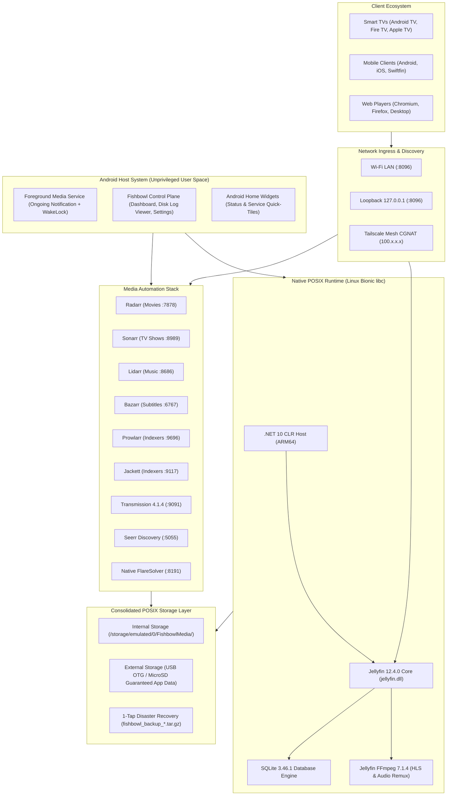

<p align="center">
  
</p>

<h1 align="center">Fishbowl</h1>

<p align="center">
  <b>Standalone Jellyfin Server 12.4.0 Host & Companion Automation Suite for Android ARM64</b><br>
  <i>Native POSIX execution on Android Bionic libc without containers, root, or virtualization.</i>
</p>

<p align="center">
  <a href="https://github.com/DenverCoder1/github-readme-typing-svg">
    
  </a>
</p>

<p align="center">
  <a href="https://github.com/Suz41/Fishbowl/actions/workflows/build.yml"></a>
  <a href="https://github.com/Suz41/Fishbowl/releases/tag/v1.4.9-beta.1"></a>
  <a href="https://jellyfin.org"></a>
  <a href="https://dotnet.microsoft.com"></a>
  <a href="https://android.com"></a>
  <a href="LICENSE"></a>
  
  
  <a href="https://github.com/Suz41/Fishbowl/stargazers"></a>
  <a href="https://github.com/Suz41/Fishbowl/network/members"></a>
</p>

<p align="center">
  <a href="#quick-start"><b>Quick Start</b></a> &bull;
  <a href="#release-notes-v149-beta1"><b>Release Notes</b></a> &bull;
  <a href="#system-architecture"><b>Architecture</b></a> &bull;
  <a href="#key-features"><b>Features</b></a> &bull;
  <a href="#service-endpoint--network-port-matrix"><b>Ports & Endpoints</b></a> &bull;
  <a href="#storage--media-setup"><b>Storage</b></a> &bull;
  <a href="#credits-acknowledgements--thanks"><b>Credits</b></a> &bull;
  <a href="#maintainer"><b>Maintainer</b></a>
</p>

> [!IMPORTANT]
> **Project Scope, Compliance Notice & Architectural Transparency:**
> - **Upstream Independence:** Fishbowl is an independent, unofficial community project and is **not affiliated with, maintained by, or endorsed by the official Jellyfin project**. Bug reports and support requests must be directed exclusively to this repository.
> - **Strictly Homelab & Lawful Media (Zero-Tolerance Anti-Piracy Policy):** Fishbowl is engineered strictly for personal homelab deployments, private media server hosting, and lawful library curation. Fishbowl **does not provide, host, stream, index, or distribute any media files, copyrighted content, or unlicensed streams**. The maintainers strictly prohibit and condemn copyright infringement. Users are exclusively responsible for adhering to applicable copyright and intellectual property laws in their jurisdictions.
> - **AI-Assisted Development Disclosure:** Engineered utilizing agentic AI coding assistants (Google Antigravity / Gemini) paired with human architectural oversight and empirical validation on physical ARM64 hardware. The compiled application runtime is 100% offline with zero cloud LLM connections, zero telemetry SDKs, and zero remote analytics.
> - **Open-Source Reproducibility & Verification:** All source code, build scripts, and packaging recipes are published openly under the GNU General Public License v3.0. Users are encouraged to inspect the codebase, audit network sockets, or compile release APKs independently directly from source via `./gradlew assembleRelease`.
> - **Thermal & Hardware Guidance:** Sustained, multi-threaded video transcoding on mobile ARM SoCs generates substantial thermal load and power consumption. For continuous server workloads, keeping the host device adequately ventilated and connected to steady AC power is strongly recommended.
> - **Licensing & Warranty:** Distributed free of charge under the GNU General Public License v3.0 (GPLv3) for homelab and personal self-hosting without commercial warranties or service-level agreements.

Fishbowl runs **Jellyfin Server 12.4.0** natively on compatible ARM64 Android devices (powered by Microsoft .NET 10.0 ARM64), providing a native interface for starting the server, viewing status, managing media storage folders, orchestrating companion automation services (including Jackett, Radarr, Sonarr, Prowlarr, Transmission, and Seerr), and accessing diagnostic logs while keeping the underlying server local to the device.

---

## Quick Start

### System Prerequisites

| Requirement | Minimum Specification | Recommended Specification |
| :--- | :--- | :--- |
| **Processor Architecture** | ARM64 (aarch64 / ARMv8 64-bit) | 8-Core ARM64 SoC (Snapdragon, Dimensity, Tensor) |
| **Android Operating System** | Android 7.0 (API 24) | Android 11.0 – Android 15.0+ |
| **System Memory (RAM)** | 2 GB RAM | 4 GB – 8 GB+ RAM |
| **Local Connectivity** | 2.4 GHz Wi-Fi or Mobile Hotspot | 5 GHz Wi-Fi (802.11ac/ax) or USB-C Ethernet |
| **Storage Allocation** | 500 MB free (App runtime) | 10 GB+ free storage (Metadata, cache & media) |

---

### Step 1: Download & Install

1. Download the latest universal release package:
   - [**Fishbowl v1.4.9-beta.1 (Pre-release)**](https://github.com/Suz41/Fishbowl/releases/tag/v1.4.9-beta.1) (`Fishbowl-v1.4.9-beta.1-release-universal.apk`)
   - **SHA-256 Verification:** `A96BDECF7A7B0B4D48EB38E655489EBDB28B264204844078201F57AF07F12414`
   - **Package Size:** 338,578,148 bytes (~322.9 MiB)
2. Install the APK on your ARM64 device.
3. Grant required runtime permissions when prompted:
   - **All-Files Storage Access (`MANAGE_EXTERNAL_STORAGE`):** Allows Jellyfin and automation tools to index video and audio files across internal and external storage volumes.
   - **Battery Optimization Exemption:** Set battery usage to **Unrestricted** (Settings -> Apps -> Fishbowl -> Battery -> Unrestricted) to prevent Android from suspending the server when the screen is locked.

---

### Step 2: Initialize the Server

1. Open Fishbowl on your device.
2. On first launch, Fishbowl automatically unpackages the native Bionic environment and initializes the .NET 10 CLR runtime.
3. The server status indicator will transition from booting to green (**SERVER RUNNING**).
4. Tap **[ OPEN JELLYFIN ]** to launch the web client interface directly in the built-in viewer or your device browser (`http://localhost:8096`).

---

### Step 3: Run the Setup Wizard & Add Media Folders

1. Select your preferred display language.
2. Create your server administrator username and password.
3. Add your media libraries:
   - Fishbowl automatically provisions a standardized storage scaffolding under internal storage:
     - **Movies:** `/storage/emulated/0/FishbowlMedia/Movies`
     - **TV Shows:** `/storage/emulated/0/FishbowlMedia/TV Shows`
     - **Music:** `/storage/emulated/0/FishbowlMedia/Music`
   - **External USB OTG / MicroSD:** If using removable drives on Android 11+, tap **Settings -> Media Storage & Folders** in Fishbowl and copy the guaranteed app directory:
     ```text
     /storage/<UUID>/Android/data/com.fishbowl.app/files
     ```
   - *Tip:* Tap **[ COPY PATH FOR JELLYFIN ]** in the app to run active sanity checks (verifying folder readability and non-empty status) before copying the path to your clipboard.
4. Complete the wizard to enter the main Jellyfin dashboard.

---

### Step 4: Connect Clients & Stream

1. Note the **LAN Address** displayed on Fishbowl's home screen (e.g. `http://192.168.1.xxx:8096`).
2. Open any official Jellyfin client (Smart TV, Android TV, Apple TV, Fire TV, Roku, iOS/Android mobile, or web browser) connected to the same Wi-Fi network.
3. Enter the server LAN address and your login credentials to begin streaming.

> [!TIP]
> **Always-On Server Recommendation:** Keep the persistent foreground service notification active, enable Wake Lock in Fishbowl settings, and keep the host device connected to AC power for uninterrupted 24/7 background streaming.

---

## Preview & Interface

<p align="center">
  
  &nbsp;
  
  &nbsp;
  
</p>

---

## Release Notes: v1.4.9-beta.1

Fishbowl `v1.4.9-beta.1` introduces native Jackett torrent indexer integration, a redesigned 5-column multi-row services dock, dual-tier home screen supervision widgets, an embedded movie importer engine, and enterprise CI/CD security hardening.

### Release Specifications
- **Core Server Engine:** Jellyfin Server 12.4.0 (.NET 10.0.12 ARM64 Bionic)
- **Target Platform:** Android ARM64 (API 21+ / Android 7.0 - 15+)
- **Indexer Proxy:** Jackett 0.22.x (Port :9117)
- **Universal APK:** [`Fishbowl-v1.4.9-beta.1-release-universal.apk`](https://github.com/Suz41/Fishbowl/releases/tag/v1.4.9-beta.1) (338,578,148 bytes)
- **SHA-256 Checksum:** `A96BDECF7A7B0B4D48EB38E655489EBDB28B264204844078201F57AF07F12414`

### Key Highlights & Changes
- **Jellyfin Server 12.4.0:** Full Bionic native runtime hosting on Android ARM64 with isolated SQLite database storage.
- **Jackett Native Indexer Proxy (:9117):** Standalone daemon with custom Blaze Orange vector icon and Torznab auto-wiring with Radarr and Sonarr.
- **5-Column Multi-Row Service Dock:** Responsive 2-tier dashboard organizing 9 managed companion services across two balanced rows.
- **Dual-Tier Android App Widgets (5x2 Grid):** Home screen widgets mirroring the in-app dock with electric crimson (`#FF1744`) crash alerting.
- **In-App Movie Importer Engine:** Integrated TMDB metadata matching, filename parsing, and automatic folder routing into library directories.
- **Bionic Runtime & Community Fixes:** Bundled `libMonoPosixHelper.so` for Android 10/11 (#35), TV setup overlay auto-dismiss (#32), Transmission 4.1.4 upgrade (#33), and POSIX path traversal (#31).
- **Enterprise CI/CD Hardening:** Provenance-gated releases, Dependabot AGP compatibility shielding (#34), and CodeQL cache isolation (#37).

### Resolved Community Issues & PRs
- **Issue #35:** Bundled native Bionic `libMonoPosixHelper.so` resolving `MonoPosixHelper` crash on Android 10/11.
- **Issue #32:** Implemented automated setup overlay dismissal and remote focus navigation for Android TV / Nvidia Shield.
- **Issue #31:** Hardened POSIX path resolution and documented `/storage/<UUID>/` traversal on removable storage.
- **PR #33:** Integrated Transmission 4.1.4 upgrade and native Bionic companion libraries (by @Salih800).
- **PR #34:** Added Dependabot version ignore rule for Gradle >= 9.6.0 to protect AGP 8.13.2 compatibility.
- **CodeQL Alert #37:** Enforced cache-read-only in release workflows to eliminate cache poisoning vectors.

> Full asset downloads and checksum manifests are available on the [GitHub Release v1.4.9-beta.1](https://github.com/Suz41/Fishbowl/releases/tag/v1.4.9-beta.1) page.

---

## Table of Contents

- [Quick Start](#quick-start)
- [Release Notes (v1.4.9-beta.1)](#release-notes-v149-beta1)
- [System Architecture](#system-architecture)
- [Key Features](#key-features)
- [Bundled Packages & System Components](#bundled-packages--system-components)
  - [Service Endpoint & Network Port Matrix](#service-endpoint--network-port-matrix)
- [Client Compatibility](#client-compatibility)
  - [Hardware Codec Capability Matrix](#hardware-codec--playback-capability-matrix)
- [Storage & Media Setup](#storage--media-setup)
- [1-Tap Backup & Restore](#1-tap-backup--restore)
- [Background Operation & Battery Guidance](#background-operation--battery-guidance)
- [Permissions & Privacy](#permissions--privacy)
- [Building From Source](#building-from-source)
- [Troubleshooting](#troubleshooting)
  - [ADB Command-Line Inspection Reference](#adb-command-line-diagnostics--inspection-reference)
- [Repository Metrics & Code Analysis](#repository-metrics--code-analysis)
- [Star History](#star-history)
- [Disclosures & License](#disclosures--license)
  - [AI-Assisted Development & In-App Offline Privacy Disclosure](#ai-assisted-development--in-app-offline-privacy-disclosure)
  - [Content, Homelab Scope & Anti-Piracy Policy](#content-homelab-scope--anti-piracy-policy)
  - [Project License & Open-Source Attributions](#project-license--open-source-attributions)
- [Credits, Acknowledgements & Thanks](#credits-acknowledgements--thanks)
- [Maintainer](#maintainer)

---

## System Architecture

Fishbowl integrates the Android application framework with a native Linux POSIX environment, executing Jellyfin and companion automation daemons directly against Android's Bionic C runtime (`libc.so`):



## Key Features

### Server & Platform Engine
- **Embedded Jellyfin 12.4.0 Core:** Direct POSIX execution on Android's Bionic C runtime (`libc.so`) without containers, emulation, or root access.
- **Embedded .NET 10 Host:** High-performance JIT execution powered by Microsoft .NET 10.0.12 (Linux Bionic ARM64).
- **Embedded FFmpeg Engine:** Bundled mobile FFmpeg binary supporting media streaming, audio remuxing, and HLS playback.
- **Local SQLite3 Database:** Embedded SQLite engine (`libe_sqlite3.so`) managing media libraries, user playback states, and metadata locally.
- **Isolated Initial Setup Wizard:** Full edge-to-edge runtime bootstrapping overlay with dynamic percentage tracking and complete chrome suppression (navigation tabs and header bars hidden), ensuring reliable extraction across Samsung Galaxy S21/S22/S23 Ultra, Pixel, and Vivo devices.
- **Crash-Resilient WebViews & Memory Supervision:** Proactive memory pressure monitoring, synchronous process state gating, and Android `onRenderProcessGone` lifecycle recovery in both `JellyfinWebActivity` and `NativeFlareSolver` preventing background renderer kills from terminating the server host process.
- **Cryptographic Package Verification:** Automatic SHA-256 integrity validation prior to applying APK updates.
- **Port Conflict & Health Guard:** Active socket loopback probing and HTTP readiness polling (`/system/info/public` and `/health`) to verify genuine server readiness and prevent collisions.

### Media Automation & Management Suite
- **1-Tap Configuration Backup & Restore:** Package all Jellyfin, Sonarr, Radarr, Prowlarr, and Transmission configs, credentials, and databases into a single timestamped `.tar.gz` archive with seamless 1-tap restore.
- **ZipSlip & Rollback Disaster Recovery:** Canonical path boundary validation against ZipSlip directory traversal attacks, paired with automatic pre-restore safety rollback snapshots to preserve working server configurations if an imported archive is damaged.
- **Dedicated Download Directory Routing:** Dedicated download staging paths for Radarr (`Downloads/radarr`) and Sonarr (`Downloads/sonarr`) to bypass label-drop issues and ensure zero import collisions.
- **Automated Deduplication Watcher:** Background storage guardian that auto-detects and purges completed staging duplicates once media is successfully imported into library folders, conserving critical flash storage.
- **Lazy On-Demand Companion Deployment:** Non-core companion services (such as Seerr media discovery engine) deploy strictly on-demand when the user chooses to install them, eliminating storage bloat and unnecessary background daemon overhead on initial launch.
- **Jackett Indexer Proxy Integration:** Native Jackett daemon integration on port :9117 with custom Blaze Orange typographic iconography, Torznab auto-wiring, and direct indexer feed translation for Radarr and Sonarr.
- **In-App Movie Importer Engine:** Embedded metadata provider, filename parsing heuristics, and download detection watcher automatically renaming and organizing incoming media into Jellyfin library paths.
- **Integrated Companion Orchestration:** Native support and health monitoring for Jellyfin, Radarr, Sonarr, Prowlarr, Jackett, Transmission daemon, Seerr (media requests), Bazarr, and Lidarr.
- **5-Column Multi-Row Service Dock:** In-app home screen dock cleanly organizing 9 managed companion services across two balanced, proportional rows.
- **Dual-Tier Android App Widgets (5x2 Grid):** Refactored home launcher widgets mirroring the 5-column in-app dock with electric crimson (#FF1744) crash alerting and real-time status beacons.

### User Interface & Diagnostics
- **Modernized Dynamic Foreground Notification:** Live bootstrap progress indicator (`Fishbowl • Setup (X%)`), real-time chronometer uptime counter, color-coded status badges (Emerald Green for running, Amber for starting, Sky Blue for setup, Crimson for errors), and quick action controls (Open Web UI, Dashboard, Stop All, Retry).
- **Unified Monospace Console with Multi-Daemon Filtering:** Live multi-daemon log terminal with dynamic service filter chips (`ALL`, `JELLYFIN`, `RADARR`, etc.), zero log duplication, and log level filtering (`ALL`, `ERR`, `WRN`, `INF`).
- **Comprehensive Error Diagnoser:** Automatically analyzes startup and runtime failures (port conflicts, SELinux blocks, database stalls, or corrupted files) and displays clear recovery instructions.
- **Network Hub:** Live display of local loopback (`127.0.0.1`), local Wi-Fi LAN IP, and Tailscale VPN CGNAT (`100.x.x.x`) addresses with 1-tap copy buttons.
- **Button Rate Limiting & Touch Feedback:** Prevents duplicate service invocations with debounced actions and immediate visual state transitions (`STARTING...`, `RUNNING`, `STOPPING...`).
- **Dual Log Console:** Real-time log terminal with auto-scroll and direct on-disk Serilog log viewer for troubleshooting.
- **Permissions Dashboard:** Live status badges (All-Files Access, Battery Optimization Exemption, Notifications) with 1-tap deep links to system settings.
- **Collapsible Settings Drawers:** Clean accordion drawers for Transcoding & Hardware Codecs, Backup & Restore, and System Components to keep the interface uncluttered.

---

## Bundled Packages & System Components

Fishbowl integrates tested native binaries and runtimes compiled for the Android ARM64 Bionic C environment (`libc.so`), eliminating the need for Linux containers, virtual machines, or chroot environments.

| Package / Component | Version / Identifier | Purpose & Role | Upstream License |
| :--- | :--- | :--- | :--- |
| **Jellyfin Media Server Core** | `12.1.0` (ARM64) | Core media server runtime (`jellyfin.dll`), library indexing, playback reporting, and REST API | [GPLv3](https://github.com/jellyfin/jellyfin) |
| **Microsoft .NET Runtime Engine** | `10.0.12` (ARM64) | High-performance managed JIT execution host located in `lib/dotnet/` | [MIT](https://github.com/dotnet/runtime) |
| **Jellyfin FFmpeg Transcoder** | `7.1.4-Jellyfin` | Native ARM64 binary located in `opt/jellyfin/bin/ffmpeg` for media remuxing, thumbnail generation, and audio transcoding | [GPLv3 / LGPLv3](https://www.ffmpeg.org/legal.html) |
| **Radarr** | `6.4.4` (ARM64) | Automated movie collection manager and metadata grabber | [GPLv3](https://github.com/Radarr/Radarr) |
| **Sonarr** | `4.0.9` (ARM64) | Smart TV series collection manager and automated indexer coordinator | [GPLv3](https://github.com/Sonarr/Sonarr) |
| **Lidarr** | `2.9.6` (ARM64) | Music collection manager and automated audio grabber | [GPLv3](https://github.com/Lidarr/Lidarr) |
| **Bazarr** | `1.4.5` (Python / Waitress) | Automated subtitle synchronization and multi-provider downloader | [GPLv3](https://github.com/morpheus65535/bazarr) |
| **Prowlarr** | `1.21.2` (ARM64) | Unified torrent indexer proxy manager integrating with Radarr, Sonarr, and Lidarr | [GPLv3](https://github.com/Prowlarr/Prowlarr) |
| **Jackett** | `0.22.x` (ARM64) | Standalone torrent indexer proxy translator translating queries into Torznab feeds | [GPLv2](https://github.com/Jackett/Jackett) |
| **Transmission Daemon** | `4.1.4` (ARM64 Bionic) | Headless native BitTorrent download client with RPC management | [GPLv2 / GPLv3](https://github.com/transmission/transmission) |
| **Seerr** | `2.2.0` (Node.js) | Media discovery, request management, and user voting portal for Jellyfin | [MIT](https://github.com/fallenbagel/jellyseerr) |
| **SQLite3 Database Driver** | `3.46.1` (`libe_sqlite3.so`) | Embedded relational database engine storing user library catalogs, metadata, and watch progress | [Public Domain](https://sqlite.org) |
| **Fontconfig & FreeType Engines** | `libfontconfig.so` / `libfreetype.so` | Native C libraries used by FFmpeg for video subtitle burn-in and font shaping | [FTL / GPLv2](https://freetype.org) |
| **OpenSSL Security & TLS Stack** | OpenSSL `3.x` (`libcrypto.so` / `libssl.so`) | Cryptographic engine managing local HTTPS sockets and secure outbound metadata requests | [Apache 2.0](https://www.openssl.org) |
| **Unicode & Globalization Engine** | ICU Runtime | Database internationalization and culture-aware metadata sorting and searching | [Unicode-DFS-2016](https://icu.unicode.org) |
| **Termux Foundation & Shell** | Core Bootstrap & Terminal | Android Bionic process management, isolated POSIX execution, and console terminal viewer | [GPLv3 / Apache 2.0](https://github.com/termux) |

### Service Endpoint & Network Port Matrix

Fishbowl coordinates and monitors the complete self-hosted media lifecycle through local loopback and LAN endpoints:

| Service | Default Port | Protocol / Transport | Engine / Runtime | Operational Role |
| :--- | :--- | :--- | :--- | :--- |
| **Jellyfin Core** | `8096` | HTTP / WebSocket | .NET 10 (ARM64) | Primary media streaming, library catalog indexing, and user playback reporting |
| **Radarr** | `7878` | HTTP / REST API | .NET 10 (ARM64) | Automated movie library management, metadata gathering, and folder organization |
| **Sonarr** | `8989` | HTTP / REST API | .NET 10 (ARM64) | Television series tracking, episode monitor, and series renaming |
| **Lidarr** | `8686` | HTTP / REST API | .NET 10 (ARM64) | Music track and album management, metadata retrieval, and organization |
| **Bazarr** | `6767` | HTTP / REST API | Python 3 (Waitress) | Subtitle synchronization engine and multi-provider subtitle downloader |
| **Prowlarr** | `9696` | HTTP / REST API | .NET 10 (ARM64) | Centralized torrent indexer proxy manager syncing with Radarr, Sonarr, and Lidarr |
| **Jackett** | `9117` | HTTP / Torznab | Native C# / .NET | Individual torrent tracker indexer proxy with Torznab API auto-wiring |
| **Transmission** | `9091` | HTTP / RPC | Native C (Bionic) | Headless BitTorrent download engine with dedicated staging directory routing |
| **Seerr** | `5055` | HTTP / WebSocket | Node.js Runtime | Media discovery, user request voting, and Jellyfin library sync |
| **Native FlareSolver** | `8191` | HTTP (Headless) | Android Chromium Engine | In-app headless challenge solver for Prowlarr indexer queries |

### Application Package & Directory Layout

All server state is strictly contained inside Fishbowl's private application package namespace (`com.fishbowl.app`):

| Directory | Filesystem Path | Contents & Persistence |
| :--- | :--- | :--- |
| **System Prefix** | `/data/data/com.fishbowl.app/files/usr` | Native binaries, .NET runtime host, shared `.so` libraries, and tools |
| **Data (`--datadir`)** | `/data/data/com.fishbowl.app/files/home/.local/share/jellyfin` | Main SQLite database (`jellyfin.db`), user accounts, and watch history (preserved across app updates) |
| **Config (`--configdir`)** | `/data/data/com.fishbowl.app/files/home/.config/jellyfin` | Server XML configuration files (`system.xml`, `network.xml`) |
| **Cache (`--cachedir`)** | `/data/data/com.fishbowl.app/files/home/.cache/jellyfin` | Image thumbnail caches, fanart, and temporary transcode chunks |
| **Logs (`--logdir`)** | `/data/data/com.fishbowl.app/files/home/.local/share/jellyfin/log` | On-disk Serilog log files accessible via the in-app Disk Log viewer |
| **Services Directory** | `/data/data/com.fishbowl.app/files/home/services` | Companion binaries and managed modules (`radarr`, `sonarr`, `lidarr`, `prowlarr`, `transmission`, `bazarr`, `seerr`) |

---

## Client Compatibility

Any client compatible with the official Jellyfin server ecosystem can connect to Fishbowl over your local network:

- **Smart TVs:** Jellyfin for Android TV, Google TV, Fire TV, Roku, Apple TV, and LG webOS.
- **Mobile Devices:** Official Jellyfin Android and iOS clients, Swiftfin, and compatible third-party players.
- **Desktop & Web:** Any modern web browser (Chrome, Firefox, Safari, Edge) or Jellyfin Media Player.
- **Media Centers:** Kodi (via the Jellyfin for Kodi add-on).

Playback capabilities depend on client capabilities, network throughput, and available hardware decoding support. For optimal performance on mobile devices, prioritize Direct Play / Direct Stream.

### Hardware Codec & Playback Capability Matrix

<details open>
<summary><b>Supported Codec Profiles & Transcoding Performance (ARM64)</b></summary>
<br />

| Codec / Container | Direct Play | Direct Stream (Remux) | CPU Software Transcode | Hardware Acceleration Notes |
| :--- | :---: | :---: | :---: | :--- |
| **H.264 / AVC** (`.mp4`, `.mkv`) | Supported | Supported | Supported (Low Load) | Native client hardware decoding supported on virtually all endpoints. |
| **H.265 / HEVC 8-bit / 10-bit** | Supported | Supported | Supported (Medium Load) | Client Direct Play recommended. 10-bit HDR tone mapping requires higher CPU budget. |
| **VP9** (`.webm`, `.mkv`) | Supported | Supported | Supported (Medium Load) | Direct Play on modern Chromium web clients and Android TV endpoints. |
| **AV1** (`.mp4`, `.mkv`) | Supported | Supported | Intensive | Direct Play supported on newer client hardware (AV1 decode capable chips). |
| **AAC / MP3 / Opus** | Supported | Supported | Negligible Load | Flawless Direct Play across all mobile, TV, and web players. |
| **FLAC / ALAC** (Lossless) | Supported | Supported | Negligible Load | Bit-perfect streaming; Direct Play on capable clients, remuxed if needed. |
| **AC3 / E-AC3 (Dolby Digital)** | Supported | Supported | Supported (Light) | Direct Play supported on Android TV and home theater receivers with bitstream passthrough. |
| **Subtitles (SRT / VTT)** | Supported | Supported | Negligible Load | Direct rendering on client without burning into video stream. |
| **Subtitles (ASS / SSA / PGS)** | Supported | Supported | Burn-in (CPU Load) | Client Direct Play recommended (e.g. Jellyfin Media Player, Exoplayer). Burn-in requires transcoding. |

> [!TIP]
> **Performance Optimization:** Configure client playback settings to **Direct Play** maximum bitrate on local Wi-Fi to eliminate server-side CPU transcode overhead and prevent thermal throttling on host Android hardware.
</details>

---

## Storage & Media Setup

Jellyfin requires direct read access to your media files. Fishbowl provides dedicated storage tools under **Settings -> Media Storage & Folders** to browse, verify, and copy paths for Jellyfin libraries.

### Standard Media Storage Structure
Fishbowl automatically provisions a clean media scaffolding under `/storage/emulated/0/FishbowlMedia/`:
```text
/storage/emulated/0/FishbowlMedia/
|-- Movies/                    # Radarr movie library root
|-- TV/                        # Sonarr TV series library root
|-- Music/                     # Lidarr & user music library root
|-- Downloads/                 # Dedicated download staging (Transmission)
|   |-- radarr/                # Radarr movie download target
|   `-- sonarr/                # Sonarr episode download target
`-- Backups/                   # 1-Tap disaster recovery archives
    `-- fishbowl_backup_YYYYMMDD_HHmmss.tar.gz
```

### Internal Storage
Grant the All-Files Storage Access permission when prompted, then select your media directory, such as:
- `/storage/emulated/0/FishbowlMedia/Movies`
- `/storage/emulated/0/FishbowlMedia/TV`
- `/storage/emulated/0/FishbowlMedia/Music`
- `/storage/emulated/0/FishbowlMedia/Downloads`

### USB OTG & External MicroSD Storage
Android 11+ OEM security restricts untrusted application UIDs from traversing raw kernel mount points (`/mnt/media_rw/`). Fishbowl resolves this through two accessible methods:
1. **Public POSIX Storage Mounts:** Fishbowl maps removable drives to standard POSIX `/storage/<UUID>/` paths and verifies directories on the active FUSE layer.
2. **Guaranteed App Data Directory:** When direct traversal on external drives is restricted by OEM SELinux policies, use the guaranteed app data directory created on the external volume:
    ```text
    /storage/<UUID>/Android/data/com.fishbowl.app/files
    ```
    Fishbowl provides a 1-tap quick chip for this path. Media placed inside this folder is guaranteed readable by the server.

### Empty Library Sanity Checks
Tapping **[ COPY PATH FOR JELLYFIN ]** verifies folder contents before copying to clipboard:
- Alerts if the directory does not exist on disk.
- Alerts if Android SELinux blocks native read access, offering a 1-tap redirect to the guaranteed app data folder.
- Alerts if 0 media files are detected, advising you to add video or audio files before initiating a library scan in Jellyfin.

---

## 1-Tap Backup & Restore

Under **Settings -> 6. Backup & Restore System**, Fishbowl provides complete disaster recovery and device migration:

- **Create Backup:** Aggregates and compresses all application configurations, databases, and keys into a timestamped archive:
  ```text
  /storage/emulated/0/FishbowlMedia/Backups/fishbowl_backup_YYYYMMDD_HHmmss.tar.gz
  ```
- **Included in Backups:**
  - Jellyfin server configuration, users, libraries, and SQLite state (`~/.config/jellyfin`, `~/.local/share/jellyfin`)
  - Radarr, Sonarr, Prowlarr, and Lidarr configurations and SQLite catalogs (`~/.config/Radarr`, `~/.config/Sonarr`, etc.)
  - Transmission daemon settings and torrent resume state (`~/.config/transmission-daemon`)
  - Seerr preferences and database (`~/.config/seerr`)
- **Restore & Rollback Protection:** Select any previous `.tar.gz` archive with 1-tap atomic restoration, automated service restart, and database integrity verification. All extracted entry paths are rigorously verified against ZipSlip directory traversal attacks, and Fishbowl automatically generates a pre-restore safety snapshot to roll back cleanly if an imported archive is corrupted.

---

## Background Operation & Battery Guidance

Android aggressively terminates background processes to conserve power. To ensure continuous server operation:

1. **Battery Optimization Exemption:** Set Fishbowl's battery usage to **Unrestricted** (or **Don't Optimize**). The exact menu name depends on your device manufacturer:
   - Samsung: Settings -> Apps -> Fishbowl -> Battery -> Unrestricted.
   - Xiaomi / HyperOS: Settings -> Apps -> Manage Apps -> Fishbowl -> Battery Saver -> No Restrictions.
   - Pixel / Stock Android: Settings -> Apps -> Fishbowl -> App Battery Usage -> Unrestricted.
2. **Foreground Service & Notification:** Keep the persistent foreground service notification enabled so Android prioritizes the process.
3. **Power Connection:** For extended streaming sessions or initial library indexing, keep the device connected to a charger.

---

## Permissions & Privacy

Fishbowl uses standard Android permissions to provide local server hosting:
- **All-Files Access (`MANAGE_EXTERNAL_STORAGE`):** Required to read user media directories on internal and external storage.
- **Foreground Service (`FOREGROUND_SERVICE`):** Prevents Android from immediately terminating the server when the app is minimized.
- **Wake Lock (`WAKE_LOCK`):** Prevents CPU deep-sleep while streaming media over the network.
- **Notifications (`POST_NOTIFICATIONS`):** Displays the persistent background service status and controls.

**Privacy Guarantee:**
- Zero tracking SDKs, zero telemetry, and zero remote analytics.
- No accounts, no registration, and no cloud dependency.
- All server databases, configurations, and media indexing remain 100% local on your device.

---

## Building From Source

### Prerequisites
- Windows, macOS, or Linux
- OpenJDK 17 or OpenJDK 21
- Android SDK (API 35) and Android NDK
- Git

### Build Instructions
```bash
# Clone the repository
git clone https://github.com/Suz41/Fishbowl.git
cd Fishbowl

# Download Termux bootstrap archives
./gradlew downloadBootstraps

# Build the debug APK
./gradlew assembleDebug

# Build the release universal APK
./gradlew assembleRelease
```

Generated APKs are located at `app/build/outputs/apk/release/Fishbowl-*-release-universal.apk`.

---

## Troubleshooting

### Initial setup shows 0% or runtime extraction is taking time
On fresh installation, Fishbowl extracts over 5,600 native POSIX binaries, libraries, and the .NET runtime. The setup overlay runs in complete edge-to-edge isolation to prevent UI race conditions on high-refresh Android devices. Please keep the app open for 30–60 seconds while extraction finishes. If interrupted, simply reopen the app; Fishbowl resumes automatically and idempotently.

### The server stops when I lock the screen or switch apps
Set Fishbowl's battery setting to **Unrestricted**. Some OEM skins (MIUI, OriginOS, ColorOS) require enabling "Autostart" and setting background limits to "No Restrictions" in system app management.

### Other devices cannot connect to the server
- Verify both devices are connected to the same local Wi-Fi network and that your router does not have "AP Isolation" or "Client Isolation" enabled.
- Verify the server status shows **SERVER RUNNING** and port 8096 is not occupied by another app.
- If using Tailscale, ensure both the host device and client device are logged into the same tailnet with active connections.

### Jellyfin library shows no media files after scanning
- Ensure the selected folder contains supported media extensions (`.mp4`, `.mkv`, `.mp3`, `.flac`, etc.).
- On external drives, verify the path starts with `/storage/<UUID>/` rather than `/mnt/media_rw/`.
- If Android SELinux blocks read access on an external drive, move your media files into the guaranteed app directory (`/storage/<UUID>/Android/data/com.fishbowl.app/files`) and select that path.

### How to update without losing library databases or user accounts
Install new release APKs directly over your existing installation. Fishbowl preserves your database, configuration files, and user libraries across upgrades. Avoid using "Clear Data" in Android settings unless you intentionally want to reset the app.

### ADB Command-Line Diagnostics & Inspection Reference

<details>
<summary><b>Operator Terminal Reference (ADB Shell & Diagnostics)</b></summary>
<br />

For homelab administrators managing or debugging Fishbowl over USB debugging or Wireless ADB (`adb connect <device-ip>:5555`):

```bash
# Stream real-time native application and service logs
adb logcat -v time -s Fishbowl:V JellyfinService:V

# Inspect running processes within the Fishbowl application namespace
adb shell "ps -ef | grep com.fishbowl.app"

# Verify active listening sockets and port bindings
adb shell "run-as com.fishbowl.app netstat -tlpn"

# Inspect application package storage permission grants
adb shell "dumpsys package com.fishbowl.app | grep -i permission"

# Verify Android deviceidle / battery optimization whitelist status
adb shell "dumpsys deviceidle whitelist | grep com.fishbowl.app"
```

</details>

---

## Repository Metrics & Code Analysis

<p align="center">
  <a href="https://github.com/Suz41/Fishbowl">
    
  </a>
  &nbsp;
  <a href="https://github.com/Suz41/Fishbowl">
    
  </a>
</p>

---

## Star History

<p align="center">
  <a href="https://star-history.com/#Suz41/Fishbowl&Date">
    <picture>
      <source media="(prefers-color-scheme: dark)" srcset="https://api.star-history.com/svg?repos=Suz41/Fishbowl&type=Date&theme=dark" />
      <source media="(prefers-color-scheme: light)" srcset="https://api.star-history.com/svg?repos=Suz41/Fishbowl&type=Date" />
      
    </picture>
  </a>
</p>

---

## Disclosures & License

### AI-Assisted Development & In-App Offline Privacy Disclosure

In the spirit of complete engineering honesty, transparency, and architectural clarity:

- **How AI Was Utilized in Development:**
  The Fishbowl project codebase, build infrastructure, and technical documentation were developed utilizing conversational agentic AI coding assistants (specifically Google Antigravity and Gemini models) in close collaboration with human developers. Specific areas where AI was employed include:
  - **Application Architecture & Component Logic:** Assisting in the authoring, refactoring, and modularization of native Android Java components (including `JellyfinController`, `JellyfinServerService`, `FishbowlActivity`, `MediaStorageManager`, and home screen supervision widgets).
  - **CI/CD & Build Automation:** Generating and hardening Gradle build configurations, ABI-specific packaging rules, Dependabot version shielding, and GitHub Actions automation workflows (`build.yml`, `release.yml`, `lint.yml`).
  - **Defensive Engineering & Security Hardening:** Identifying potential edge cases, path traversal risks (such as ZipSlip vulnerability analysis in archive extraction), and authoring robust unit test suites (`BackupRestoreSecurityTest`, `MediaStorageCleanupTest`, `ProcessSupervisionTest`, `UpdateManagerSecurityTest`).
  - **Documentation & Technical Schematics:** Drafting architectural documentation, port matrix tables, hardware codec capability guides, and Mermaid system workflow diagrams.

- **Human Architectural Direction & Physical Device Validation:**
  All AI-generated code, patches, and configurations were strictly directed, reviewed, and verified by human maintainers. Crucially, all builds undergo manual empirical testing on physical ARM64 Android devices (including Samsung Galaxy smartphones, tablets, Nvidia Shield, and Android TV hardware) to ensure real-world stability, thermal safety, and functional accuracy.

- **100% Offline Application Runtime & Zero AI Telemetry:**
  While AI tools were utilized during the development and authoring phase, the compiled Fishbowl application runtime is **completely offline and contains zero AI models, zero cloud LLM connections, zero analytics SDKs, and zero telemetry**. Early experimental prototypes briefly explored in-app AI fix / Copilot features; **all such experimental code and LLM endpoints have been completely decommissioned and removed from the application** to guarantee an isolated, secure, and privacy-first local media server where no user data or prompt ever leaves the host device.

- **Open Code Auditing & Reproducibility:**
  Because this project uses an AI-assisted development workflow, we place paramount importance on open scrutiny. Every line of source code, patch, and build script is openly published in this repository. Users are actively encouraged to inspect the code, decompile the APK, monitor background sockets, and verify builds independently by compiling from source via `./gradlew assembleRelease`.

### Content, Homelab Scope & Anti-Piracy Policy

Fishbowl is engineered exclusively as a **personal homelab server hosting and media library organization utility**. It is strictly **NOT designed, intended, licensed, or provided for piracy, unauthorized file-sharing, or copyright infringement**.

- **Homelab & Personal Self-Hosting Use Only:** Fishbowl is created for homelab enthusiasts, self-hosters, and developers seeking to run local server infrastructure on low-power ARM64 Android hardware. Intended lawful use cases include:
  - Streaming private family videos, home recordings, and personal photo and music archives.
  - Hosting legally acquired, digitized personal backups of physical media owned by the user.
  - Curating open-access cultural media, public domain films, and Creative Commons audio and video works.
  - Experimenting with ARM64 POSIX process management, Bionic C runtime hosting, and local home networking.
- **Zero Bundled Content:** The software ships exclusively as hosting infrastructure and automation orchestration daemons. No movies, television shows, audio files, torrent streams, or proprietary copyright-protected media are included, indexed, hosted, or provided.
- **Absolute Anti-Piracy Position:** The developers strictly condemn copyright infringement and illegal content distribution. Fishbowl does not operate, link to, or affiliate with any torrent indexers, public trackers, or unauthorized repositories.
- **User Legal Responsibility:** Users are 100% legally responsible for verifying that all media content stored on or streamed from their personal server complies with all applicable local, national, and international intellectual property and copyright laws.

### Project License & Open-Source Attributions

Fishbowl is an unofficial community project and is not supported, maintained, or endorsed by the official Jellyfin project.

This project is licensed under the [GNU General Public License v3.0](LICENSE). For complete third-party attributions, component licenses, and GPLv3 Section 6 corresponding source disclosures, see [THIRD_PARTY_LICENSES.md](THIRD_PARTY_LICENSES.md).

- **Fishbowl:** Licensed under the GNU General Public License v3.0 (GPLv3).
- **Jellyfin Media Server Core:** Licensed under GNU General Public License v3.0 (GPLv3).
- **Jackett Indexer Proxy:** Licensed under GNU General Public License v2.0 (GPLv2).
- **Radarr / Sonarr / Prowlarr / Lidarr:** Licensed under GNU General Public License v3.0 (GPLv3).
- **Bazarr:** Licensed under GNU General Public License v3.0 (GPLv3).
- **Transmission BitTorrent Daemon:** Licensed under GNU General Public License v2.0 / v3.0.
- **Seerr (Jellyseerr):** Licensed under the MIT License.
- **Termux Subsystems & Shared Libraries:** Licensed under GNU General Public License v3.0 / Apache 2.0 / MIT.
- **Node.js LTS:** Licensed under the MIT License.
- **Python Runtime:** Python Software Foundation License (PSFL).
- **Microsoft .NET Runtime Engine:** Licensed under the MIT License.
- **Jellyfin FFmpeg Engine:** Licensed under GNU General Public License v3.0 / LGPL v3.0 (built without `--enable-nonfree`).
- **SQLite Database Engine:** Public Domain.

This application is provided freely without warranties or service-level guarantees. Always back up important library configurations and use this project for personal experimentation and home-lab use only.

---

## Credits, Acknowledgements & Thanks

We extend our sincere gratitude and appreciation to the open-source projects, maintainers, and community members whose work makes Fishbowl possible:

- **The Jellyfin Project & Contributors:** For creating an outstanding, privacy-first, community-driven media server (<https://jellyfin.org>).
- **The Jackett Maintainers & Contributors:** For developing an exceptional, versatile torrent indexer proxy translator (<https://github.com/Jackett/Jackett>).
- **The Servarr Community:** The dedicated teams behind **Radarr, Sonarr, Prowlarr, Lidarr, and Bazarr** for creating the definitive automated media collection and subtitle management ecosystem.
- **The Transmission Project:** For maintaining an efficient, ultra-lightweight, and rock-solid native BitTorrent client (<https://transmissionbt.com>).
- **Fallenbagel & the Overseerr/Jellyseerr Team:** For designing a beautiful, intuitive, and modern media discovery and request management portal (<https://github.com/fallenbagel/jellyseerr>).
- **Fredrik Fornwall, agnostic-apollo, and the Termux Project:** For groundbreaking work on Android Bionic POSIX process management and terminal environment packages (<https://github.com/termux>).
- **Salih800:** For dedicated community collaboration, companion service integration (PR #33), and diagnostic testing on Android TV hardware.
- **Community Issue Reporters & Testers:** Special thanks to community members (including @r-n-g and @Salih800) whose diagnostic feedback helped isolate and resolve issues across Android 10, 11, 14, and 15 devices.

---

## Maintainer

Fishbowl is created, maintained, and actively developed by **Sujal Achari** ([@Suz41](https://github.com/Suz41)).
