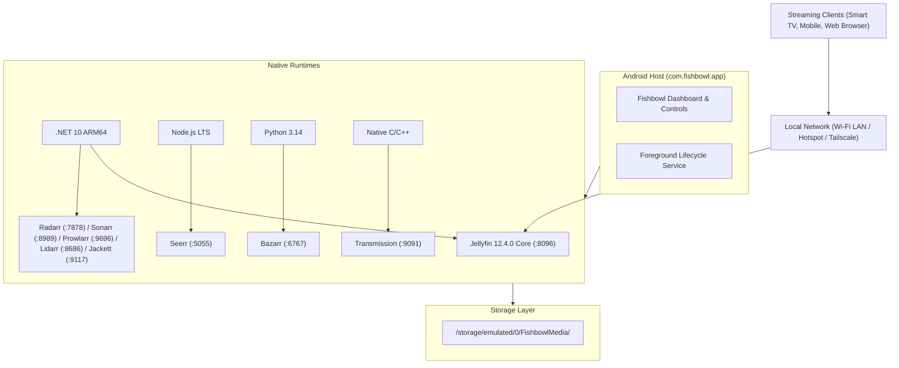

<p align="center">
  
</p>

<h1 align="center">Fishbowl</h1>

<p align="center">
  <b>Standalone Jellyfin Server 12.4.0 Host & Companion Automation Suite for Android ARM64</b><br>
  <i>Native POSIX execution on Android Bionic libc without containers, root, or virtualization.</i>
</p>

<p align="center">
  <a href="https://github.com/Suz41/Fishbowl/actions/workflows/build.yml"></a>
  <a href="https://github.com/Suz41/Fishbowl/releases/tag/v1.4.10-beta.2"></a>
  <a href="https://jellyfin.org"></a>
  <a href="https://dotnet.microsoft.com"></a>
  <a href="https://android.com"></a>
  <a href="LICENSE"></a>
</p>

---

## Overview

Fishbowl runs Jellyfin Server 12.4.0 natively on ARM64 Android devices using Microsoft .NET 10.0 and Android Bionic libc. It provides an all-in-one local media server hosting environment with integrated companion automation daemons, background execution management, and hardware monitoring.

- **No Root Required:** Executes directly in unprivileged user space.
- **Embedded .NET 10 Runtime:** High-performance JIT execution tailored for ARM64 Bionic.
- **Companion Automation Stack:** Integrated management for Radarr, Sonarr, Prowlarr, Jackett, Transmission, Bazarr, Seerr, and Lidarr.
- **100% Offline & Private:** Zero telemetry, no external accounts, no cloud dependencies.

---

## Architecture



---

## Service Endpoints & Ports

All services bind to local loopback and the active LAN IP:

| Service | Default Port | Runtime | Purpose |
| :--- | :--- | :--- | :--- |
| **Jellyfin Core** | `8096` | .NET 10.0 ARM64 | Media streaming server & library management |
| **Radarr** | `7878` | .NET 10.0 ARM64 | Automated movie management |
| **Sonarr** | `8989` | .NET 10.0 ARM64 | Automated TV series management |
| **Prowlarr** | `9696` | .NET 10.0 ARM64 | Indexer proxy and manager |
| **Jackett** | `9117` | .NET 10.0 ARM64 | Torznab indexer translator |
| **Transmission** | `9091` | Native C (Bionic) | BitTorrent download daemon |
| **Bazarr** | `6767` | Python 3.14 | Subtitle downloader and synchronizer |
| **Seerr** | `5055` | Node.js LTS | Media discovery and requests portal |
| **Lidarr** | `8686` | .NET 10.0 ARM64 | Music management and automation |

---

## Quick Start

### Prerequisites
- ARM64 Android device (aarch64 / ARMv8 64-bit)
- Android 7.0 (API 24) or newer (Android 11–16 recommended)
- 4 GB+ RAM recommended for running multiple services simultaneously

### Installation & Setup
1. Download the latest release APK from [Releases](https://github.com/Suz41/Fishbowl/releases/tag/v1.4.10-beta.2).
2. Install the APK and grant required permissions:
   - **All-Files Storage Access (`MANAGE_EXTERNAL_STORAGE`):** Required for indexing media folders.
   - **Battery Optimization Exemption:** Set battery usage to **Unrestricted** to allow continuous background streaming.
3. Launch Fishbowl and wait for initial runtime extraction (one-time setup).
4. Tap **Start Server** to start Jellyfin, then tap **Open Jellyfin** to complete the initial setup wizard at `http://localhost:8096`.
5. Access companion services from the **Services** tab and start individual services as needed.

---

## Media Storage Structure

Fishbowl provisions a standardized directory layout on internal storage:

```text
/storage/emulated/0/FishbowlMedia/
|-- Movies/       # Movie library
|-- TV/           # TV show library
|-- Music/        # Music library
|-- Downloads/    # Download staging
`-- Backups/      # Timestamped configuration backups
```

For external storage (USB OTG or MicroSD), use the guaranteed app directory:
```text
/storage/<UUID>/Android/data/com.fishbowl.app/files
```

---

## Backup & Recovery

Under **Settings -> Backup & Restore System**, Fishbowl provides 1-tap backup and recovery:
- Compresses all database, XML configurations, and service credentials into `/storage/emulated/0/FishbowlMedia/Backups/`.
- Safe atomic restoration with pre-restore safety snapshots and ZipSlip boundary validation.

---

## Building from Source

```bash
# Clone the repository
git clone https://github.com/Suz41/Fishbowl.git
cd Fishbowl

# Run unit tests
./gradlew testDebugUnitTest

# Build debug APK
./gradlew assembleDebug

# Build release universal APK
./gradlew assembleRelease
```

---

## Compliance & Disclaimer

- **Unofficial Community Project:** Fishbowl is an independent open-source project and is not affiliated with, endorsed by, or maintained by the official Jellyfin project.
- **Homelab & Lawful Media Scope:** Fishbowl is strictly a self-hosted media server management utility. It does not provide, host, index, or distribute any copyrighted content. Users are solely responsible for ensuring compliance with all applicable copyright and intellectual property laws.
- **License:** Licensed under the [GNU General Public License v3.0 (GPLv3)](LICENSE). See [THIRD_PARTY_LICENSES.md](THIRD_PARTY_LICENSES.md) for third-party component licenses.

---

## Maintainer

Created and maintained by **Sujal Achari** ([@Suz41](https://github.com/Suz41)).
